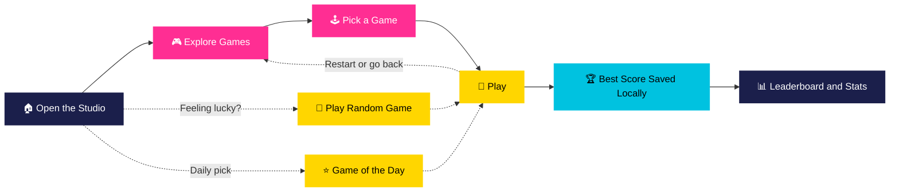

<table width="100%">
<tr>
<td width="15%" align="center">

</td>
<td width="70%" align="center">

</td>
<td width="15%" align="center">

</td>
</tr>
</table>

<div align="center">

<h3>One Studio. Endless Fun. &nbsp; 🎮 🎲 🃏 🧩 ⭐ 🎯</h3>


<br/>

<a href="https://shahrishabh1513-jsk.github.io/RT_GAMING_STUDIO/"></a>
<a href="https://github.com/shahrishabh1513-jsk/RT_GAMING_STUDIO"></a>
<a href="https://github.com/shahrishabh1513-jsk/RT_GAMING_STUDIO/stargazers"></a>

<br/>


</div>

<br/>

<div align="center">

[](#-live-preview)
[](#-about-the-project)
[](#-key-features)
[](#-site-sections)
[](#-how-it-works)
[](#-tech-stack)
[](#-project-structure)
[](#-getting-started)
[](#-connect)

</div>

<div align="center"></div>

## 🔍 Live Preview

<div align="center">

<table width="90%">
<tr>
<td>🔴 🟡 🟢 &nbsp;&nbsp; <code>shahrishabh1513-jsk.github.io/RT_GAMING_STUDIO</code></td>
</tr>
<tr>
<td align="center">
<a href="https://shahrishabh1513-jsk.github.io/RT_GAMING_STUDIO/" target="_blank">

</a>
</td>
</tr>
</table>

<br/>

<a href="https://shahrishabh1513-jsk.github.io/RT_GAMING_STUDIO/" target="_blank"></a>
<a href="https://shahrishabh1513-jsk.github.io/RT_GAMING_STUDIO/#games" target="_blank"></a>

</div>

> 💡 The preview is captured live by a free screenshot service. If it shows the "Preparing Your Playground…" loading screen, refresh once and it fills in.

<div align="center"></div>

## 📖 About The Project

<table>
<tr>
<td width="60%" valign="top">

**RT GAMING STUDIO** is a browser-based playground that brings **30+ interactive mini games** together in one place — puzzles, board games, arcade challenges, strategy and casual games, all built with **HTML, CSS, and JavaScript**.

There's nothing to install and nothing to sign up for. Open the page, pick a game (or let it pick one for you), beat your best score, and come back for the next one. Best scores and stats are kept **locally in your browser**.

> 💡 Built for the love of play — one playful playground, no frameworks, no setup.

</td>
<td width="40%" valign="top">

| At a glance | |
|---|---|
| 🎮 **Type** | Browser mini-games hub |
| 🕹 **Games** | 30+ interactive games |
| 🗂 **Categories** | Puzzle · Board · Arcade · Strategy · Casual |
| 💾 **Scores** | Saved locally in the browser |
| 📱 **Devices** | Desktop & mobile (touch controls) |

</td>
</tr>
</table>

<div align="center"></div>

## ✨ Key Features

<table>
<tr>
<td width="50%" valign="top" align="center">


<div align="left">

- No installs — just click and play
- Pure browser tech: HTML, CSS & JavaScript
- Loading screen: "Preparing Your Playground…"

</div>

</td>
<td width="50%" valign="top" align="center">


<div align="left">

- Puzzle, Board Games, Arcade, Strategy & Casual
- 30+ mini games in one studio
- Quick jump from the Categories section

</div>

</td>
</tr>
<tr>
<td width="50%" valign="top" align="center">


<div align="left">

- **Game of the Day** spotlight with a Play Now button
- **Play Random Game** for a surprise pick
- **Explore Games** grid to browse everything

</div>

</td>
<td width="50%" valign="top" align="center">


<div align="left">

- **Leaderboard & Stats** section
- Scores saved locally in your browser
- Reset local statistics any time
- Local to your device — not a global ranking

</div>

</td>
</tr>
<tr>
<td width="50%" valign="top" align="center">


<div align="left">

- Touch controls where it matters
- Responsive layout with a ☰ menu on small screens
- Works on desktop, tablet & phone

</div>

</td>
<td width="50%" valign="top" align="center">


<div align="left">

- **↻ Restart** and **← Back to Games** controls in-game
- One-page navigation: Home, Games, Categories, Leaderboard, About
- Playful, colourful visual identity

</div>

</td>
</tr>
</table>

<div align="center"></div>

## 🧩 Site Sections

The whole studio lives on one page — each section is an anchor on the live site.

<div align="center">

| Section | What's in it | Open |
|:---:|---|:---:|
| 🏠 **Home** | Hero, "One Studio. Endless Fun.", Explore Games & Play Random Game | [](https://shahrishabh1513-jsk.github.io/RT_GAMING_STUDIO/#home) |
| 🎮 **Games** | Game grid, Game of the Day, random pick | [](https://shahrishabh1513-jsk.github.io/RT_GAMING_STUDIO/#games) |
| 🗂 **Categories** | Puzzle, Board Games, Arcade, Strategy, Casual | [](https://shahrishabh1513-jsk.github.io/RT_GAMING_STUDIO/#categories) |
| 🏆 **Leaderboard** | Local best scores & stats, with reset | [](https://shahrishabh1513-jsk.github.io/RT_GAMING_STUDIO/#leaderboard) |
| 💬 **About** | Instant Play, Game Categories, Mobile Friendly, Save Best Scores | [](https://shahrishabh1513-jsk.github.io/RT_GAMING_STUDIO/#about) |

</div>

<div align="center"></div>

## 🧭 How It Works



<div align="center"></div>

## 🧰 Tech Stack

<div align="center">

| Layer | Technology | Purpose |
|:---:|:---:|:---|
| **Structure** |  | Single-page layout & sections |
| **Styling** |  | Playful theme & responsive design |
| **Logic** |  | Game logic, scores & navigation — no frameworks |
| **Storage** |  | Best scores & stats kept on the device |
| **Version Control** |   | Source control |
| **Hosting** |  | Live deployment |

</div>

<p align="center"><b>No build tools · No <code>npm install</code> · No frameworks — clone it and open it.</b></p>

<div align="center"></div>

## 📂 Project Structure

```bash
RT_GAMING_STUDIO/
│
├── index.html            # The whole studio — all sections on one page
├── style.css             # Styles
├── script.js             # Games, scores & navigation
├── Rishabh_Badge.png     # Footer badge
│
└── README.md
```

<div align="center"></div>

## 🚀 Getting Started

<table>
<tr>
<td width="50%" valign="top">

**Option 1 — Play online**

No setup needed 👉 **[Open RT GAMING STUDIO](https://shahrishabh1513-jsk.github.io/RT_GAMING_STUDIO/)**

</td>
<td width="50%" valign="top">

**Option 2 — Run it locally**

```bash
git clone https://github.com/shahrishabh1513-jsk/RT_GAMING_STUDIO.git
cd RT_GAMING_STUDIO

# open index.html in your browser
# (or use Live Server in VS Code)
```

</td>
</tr>
</table>

✅ No build tools, dependencies, or installations required — it's a pure **HTML/CSS/JS** project.

<div align="center"></div>

## 🎯 Roadmap

<table>
<tr>
<td width="50%" valign="top">

**✅ Done**
- [x] 30+ mini games in one studio
- [x] Five game categories
- [x] Game of the Day & Play Random Game
- [x] Local best scores & stats
- [x] Mobile-friendly touch controls

</td>
<td width="50%" valign="top">

**🚧 Up next**
- [ ] 🌍 Global leaderboard (needs a backend)
- [ ] ➕ More games & categories
- [ ] 🏅 Achievements & badges
- [ ] 📲 Installable PWA with offline play

</td>
</tr>
</table>

<div align="center"></div>

## 🤝 Connect

<div align="center">

**Rishabh Alpeshabhai Shah**

<a href="https://rishabh-shah-portfolio.netlify.app/"></a>
<a href="https://www.linkedin.com/in/rishabh-alpeshabhai-shah-91b9072a6/"></a>
<a href="mailto:shahrishu1515@gmail.com"></a>
<a href="https://github.com/shahrishabh1513-jsk"></a>

<br/><br/>

### ⭐ If you enjoyed the games, give it a star!


<br/>

**Made for the love of play 🎮 by Rishabh Shah**


</div>
