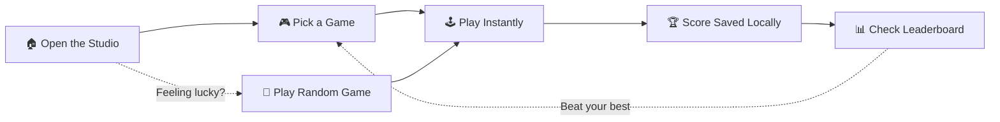

<table width="100%">
<tr>
<td width="15%" align="center">

</td>
<td width="70%" align="center">

</td>
<td width="15%" align="center">

</td>
</tr>
</table>

<div align="center">

<h3>One Studio. Endless Fun.</h3>


<br/>

<a href="https://shahrishabh1513-jsk.github.io/RT_GAMING_STUDIO/"></a>
<a href="https://github.com/shahrishabh1513-jsk/RT_GAMING_STUDIO"></a>
<a href="https://github.com/shahrishabh1513-jsk/RT_GAMING_STUDIO/stargazers"></a>

<br/>


<br/>


</div>

<br/>

<table align="center">
<tr>
<td align="center" width="20%"><sub>GAMES</sub><br><b>30+</b></td>
<td align="center" width="20%"><sub>CATEGORIES</sub><br><b>5</b></td>
<td align="center" width="20%"><sub>COST</sub><br><b>Free</b></td>
<td align="center" width="20%"><sub>INSTALL</sub><br><b>None</b></td>
<td align="center" width="20%"><sub>SCORES</sub><br><b>Saved Locally</b></td>
</tr>
</table>

<div align="center">

[](#-live-preview)
[](#-screenshots)
[](#-about-the-project)
[](#-key-features)
[](#-site-map)
[](#-tech-stack)
[](#-folder-structure)
[](#-getting-started)
[](#-connect)

</div>

<div align="center"></div>

## 🔍 Live Preview

<div align="center">
<a href="https://shahrishabh1513-jsk.github.io/RT_GAMING_STUDIO/" target="_blank">

</a>

<sub>👆 Click to open the live studio</sub>

<br/><br/>

<a href="https://shahrishabh1513-jsk.github.io/RT_GAMING_STUDIO/" target="_blank">
  
</a>
<a href="https://shahrishabh1513-jsk.github.io/RT_GAMING_STUDIO/#games" target="_blank">
  
</a>
<a href="https://shahrishabh1513-jsk.github.io/RT_GAMING_STUDIO/#leaderboard" target="_blank">
  
</a>

</div>

<div align="center"></div>

## 📸 Screenshots

> 💡 **How to add your own:** take a screenshot of each screen, save it inside a `screenshots/` folder in the repo, then replace each placeholder link below with `screenshots/your-file.png`.

<div align="center">

<table>
<tr>
<td align="center" width="50%">

<br/><b>🏠 Home Screen</b>
<br/><sub>Hero section with Explore Games & Play Random Game</sub>
</td>
<td align="center" width="50%">

<br/><b>🎮 Games Grid</b>
<br/><sub>Browse every game with Game of the Day</sub>
</td>
</tr>
<tr>
<td align="center" width="50%">

<br/><b>🕹️ Gameplay</b>
<br/><sub>Play instantly with Restart and Back to Games</sub>
</td>
<td align="center" width="50%">

<br/><b>🏆 Leaderboard & Stats</b>
<br/><sub>Best scores saved locally in your browser</sub>
</td>
</tr>
<tr>
<td align="center" colspan="2">

<br/><b>📱 Mobile View</b>
<br/><sub>Responsive layout with touch controls where it matters</sub>
</td>
</tr>
</table>

</div>

<div align="center"></div>

## 📖 About The Project

**RT Gaming Studio** is a browser-based arcade that brings **30+ interactive mini games** together in one playful digital playground. Explore puzzles, board games, arcade challenges and strategy games — all built with pure **HTML, CSS and JavaScript**, with no frameworks and no installs.

Pick a game, jump in, and try to beat your best score. Your stats are stored locally in your browser, so there is no sign-up and no server involved.

<div align="center">

| | |
|---|---|
| 🎮 **Type** | Browser Mini-Games Collection |
| 🎯 **Built For** | Anyone who wants quick, fun games without installing anything |
| 🗂️ **Categories** | Puzzle · Board Games · Arcade · Strategy · Casual |
| 🏆 **Scores** | Saved locally per browser and device |
| 🌐 **Hosting** | GitHub Pages |

</div>

<div align="center"></div>

## ✨ Key Features

<table>
<tr>
<td width="50%" valign="top">

### 🎮 Games
- 🕹️ **30+ mini games** in a single studio
- 🧩 Classic and modern titles, from puzzles to arcade
- 🎯 Featured titles include **Candy Crush**, **Archery**, **Speed Typing** and **Breakout**
- 🔁 **Restart** and **Back to Games** controls in every game

</td>
<td width="50%" valign="top">

### ⚡ Instant Play
- 🚀 **No installs** — just click and play
- 🎲 **Play Random Game** button for a surprise pick
- ⭐ **Game of the Day** spotlight on the home page
- ⏳ Smooth loading screen: "Preparing Your Playground..."

</td>
</tr>
<tr>
<td width="50%" valign="top">

### 🗂️ Organized Library
- 🧩 **Puzzle** games
- ♟️ **Board** games
- 👾 **Arcade** challenges
- 🧠 **Strategy** and 🎈 **Casual** games

</td>
<td width="50%" valign="top">

### 🏆 Scores & Devices
- 💾 **Best scores** stored locally in your browser
- 📊 **Leaderboard & Stats** section with a reset option
- 📱 **Mobile friendly** with touch controls
- 🔒 No account, no tracking, no backend

</td>
</tr>
</table>

<div align="center"></div>

## 🧭 Site Map

<div align="center">

| Section | Description |
|:---:|---|
| 🏠 **[Home](https://shahrishabh1513-jsk.github.io/RT_GAMING_STUDIO/#home)** | Welcome hero, Explore Games and Play Random Game buttons |
| 🎮 **[Games](https://shahrishabh1513-jsk.github.io/RT_GAMING_STUDIO/#games)** | Full game library with Game of the Day |
| 🗂️ **[Categories](https://shahrishabh1513-jsk.github.io/RT_GAMING_STUDIO/#categories)** | Puzzle, Board, Arcade, Strategy and Casual |
| 🏆 **[Leaderboard](https://shahrishabh1513-jsk.github.io/RT_GAMING_STUDIO/#leaderboard)** | Local best scores and stats |
| ℹ️ **[About](https://shahrishabh1513-jsk.github.io/RT_GAMING_STUDIO/#about)** | About the studio and its highlights |

</div>

### 🎯 How It Works



<div align="center">

**01** Open the studio &nbsp;→&nbsp; **02** Pick a game &nbsp;→&nbsp; **03** Play and score &nbsp;→&nbsp; **04** Beat your best

</div>

<div align="center"></div>

## 🧰 Tech Stack

<div align="center">

| Category | Technology | Purpose |
|:---:|:---:|:---|
| **Markup** |  | Page structure |
| **Styling** |  | Layout, theme and responsive design |
| **Logic** |  | Game logic, navigation and score tracking |
| **Storage** |  | Local best scores, no backend |
| **Version Control** |   | Source control |
| **Editor** |  | Development |
| **Deployment** |  | Live hosting |

</div>

<div align="center"></div>

## 📂 Folder Structure

<details>
<summary><b>Click to expand the folder structure 📁</b></summary>

```bash
RT_GAMING_STUDIO/
│
├── index.html            # Main page: home, games, categories, leaderboard, about
├── style.css             # Styling, theme and responsive layout
├── script.js             # Game logic, navigation and local score storage
├── Rishabh_Badge.png     # Developer badge image
├── screenshots/          # (optional) Screenshots used in this README
└── README.md             # Project documentation
```

</details>

<div align="center"></div>

## 🚀 Getting Started

### Option 1 — Play the live version

No setup needed 👉 **[Open RT Gaming Studio](https://shahrishabh1513-jsk.github.io/RT_GAMING_STUDIO/)**

### Option 2 — Run it locally

```bash
# 1️⃣ Clone the repository
git clone https://github.com/shahrishabh1513-jsk/RT_GAMING_STUDIO.git

# 2️⃣ Navigate into the project directory
cd RT_GAMING_STUDIO

# 3️⃣ Serve it locally (or simply double-click index.html)
python -m http.server 8000
```

Then open `http://localhost:8000` in your browser.

✅ No build tools, dependencies or installations required. It is a pure **HTML / CSS / JS** project.

<div align="center"></div>

## 🔒 Data & Privacy

Scores and statistics are stored **locally in your browser**. There is no backend server and no account system.

- ✅ No sign-up required
- ✅ Nothing is sent to any server
- ⚠️ Clearing browser data will erase your saved scores
- ⚠️ Scores do not sync across devices or browsers (by design)

> ℹ️ The leaderboard is **local to this browser and device**. It is not a global ranking.

<div align="center"></div>

## 🏁 Roadmap

- [x] 30+ mini games in one studio
- [x] Categories: Puzzle, Board, Arcade, Strategy, Casual
- [x] Game of the Day and Play Random Game
- [x] Local best scores and stats
- [x] Mobile friendly with touch controls
- [ ] 🌐 Global online leaderboard
- [ ] 🎮 More new games every update
- [ ] 🌙 Theme switcher
- [ ] 🔊 Sound effects and music toggle

<div align="center"></div>

## 🤝 Connect

<div align="center">

**Rishabh Alpeshabhai Shah**

<a href="https://rishabh-shah-portfolio.netlify.app/"></a>
<a href="https://www.linkedin.com/in/rishabh-alpeshabhai-shah-91b9072a6/"></a>
<a href="mailto:shahrishu1515@gmail.com"></a>
<a href="https://github.com/shahrishabh1513-jsk"></a>

</div>

---

<div align="center">

### ⭐ If you enjoyed the games, give this repo a star!


<br/>

**Made with 🎮 & 💜 by Rishabh Shah (RT1504)**


</div>
